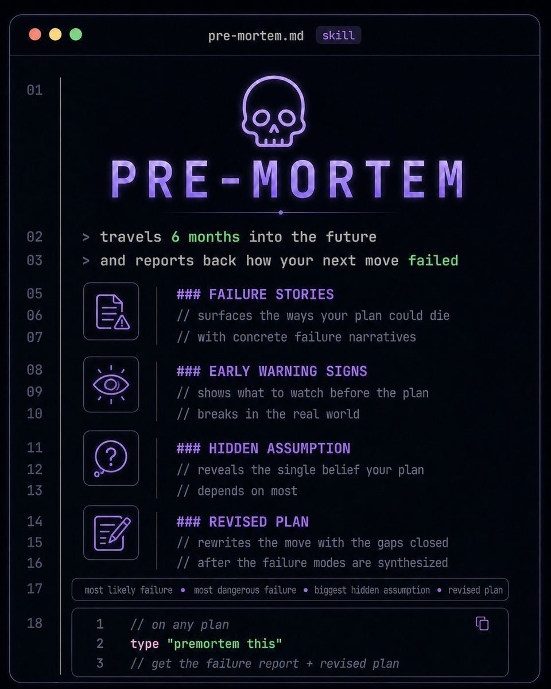

# PRE-MORTEM 🔮

<p align="center">
  
</p>

Premortem is a future-prediction AI model designed to explore possible futures, uncover opportunities, and identify the decisions that lead to success.

Imagine traveling six months into the future and discovering that your plan worked better than expected. What happened along the way? Which decisions made the biggest difference? What opportunities did you recognize early? Which assumptions turned out to be correct?

Premortem works backward to help you understand how to make it happen.

> Travel six months into the future. Discover what worked. Bring the insights back to the present.

## Core Concept

Premortem transforms a proposed plan into a structured analysis of potential success.

Given a plan, objective, strategy, or decision, the model explores plausible positive outcomes and reasons backward to identify the conditions, decisions, and opportunities that could make them possible.

```text
INPUT: Your plan, strategy, or next move
                    |
                    v
          +-------------------+
          |  FUTURE SIMULATION |
          |                    |
          |  T + 6 MONTHS      |
          +-------------------+
                    |
                    v
          +-------------------+
          |  SUCCESS ANALYSIS  |
          |                    |
          |  What went right?  |
          +-------------------+
                    |
          +---------+---------+
          |         |         |
          v         v         v
        SUCCESS   GROWTH    HIDDEN
        STORIES   SIGNALS  ADVANTAGES
          |         |         |
          +---------+---------+
                    |
                    v
            ACTIONABLE INSIGHTS
```

## What It Does

### 1. Success Stories

Discover the paths that could lead your plan to succeed.

- Generates plausible narratives describing how your plan achieves its goals.
- Identifies the decisions and events that contribute most to success.
- Maps opportunities, strategic advantages, and positive feedback loops.
- Explores multiple pathways to the desired outcome.
- Identifies high-leverage actions that could accelerate progress.

### 2. Early Opportunity Signals

Recognize what to watch for before an opportunity becomes obvious to everyone else.

- Identifies signals associated with emerging opportunities.
- Highlights milestones and metrics that indicate positive momentum.
- Detects changes in customer behavior, market conditions, or project performance.
- Suggests checkpoints for recognizing when a strategy is working.
- Prioritizes opportunities by potential impact, timing, and feasibility.

### 3. Hidden Advantages

Reveal the overlooked strengths and assumptions that could make your plan work.

- Identifies existing advantages and underutilized resources.
- Extracts assumptions that support the plan's success.
- Highlights capabilities, relationships, and dependencies that create leverage.
- Identifies areas where a small improvement could produce disproportionate results.
- Reveals what makes the plan uniquely positioned to succeed.

### 4. Alternative Futures

Explore different ways your desired future could unfold.

- Simulates multiple positive outcomes.
- Compares conservative, expected, and ambitious scenarios.
- Evaluates how different decisions influence potential results.
- Identifies alternative routes toward the same objective.
- Explores what happens when promising opportunities emerge unexpectedly.

### 5. Success Strategies

Turn future insights into actions you can take today.

- Converts successful future scenarios into concrete next steps.
- Prioritizes actions by expected impact and feasibility.
- Identifies milestones that validate progress.
- Recommends ways to build on early wins.
- Develops contingency strategies that preserve flexibility as conditions change.

## Installation

Clone the repository:

```bash
git clone https://github.com/YOUR_USERNAME/premortem.git
cd premortem
```

Install the project dependencies:

```bash
pip install -r requirements.txt
```

> The package installation and API below are illustrative until the implementation and dependency configuration are finalized.

## Usage

Premortem accepts a proposed plan and generates a structured analysis of how it could succeed.

```python
from premortem import Premortem

# Initialize the model
model = Premortem(
    horizon_months=6,
    scenarios=5,
    identify_opportunities=True,
    analyze_hidden_advantages=True,
)

# Define the plan to evaluate
plan = """
Launch a new AI-powered product within six months.

Objectives:
- Acquire 10,000 active users
- Maintain infrastructure costs within budget
- Achieve product-market fit
- Build a sustainable growth strategy
"""

# Explore possible futures
report = model.analyze(plan)

# Review the results
print(report.success_stories)
print(report.opportunity_signals)
print(report.hidden_advantages)
print(report.action_plan)
```

### Example Output

```text
PRE-MORTEM REPORT
=================

Forecast Horizon: 6 Months
Analysis Type: Hypothetical Future-Success Simulation

[SUCCESS STORY #1]
The product reached its growth target by focusing on a
high-retention user segment and turning early users into
a reliable source of referrals.

Key Success Factors:
- Strong product-market alignment.
- Rapid feedback and product iteration.
- Efficient user acquisition.
- Consistent improvements to user retention.

[EARLY OPPORTUNITY SIGNALS]
- Increasing organic signups.
- Improving user retention across successive cohorts.
- Rising referrals from existing users.

[HIDDEN ADVANTAGE]
The product's most engaged early users represent an
underutilized distribution channel.

[RECOMMENDED ACTION]
Identify the behaviors shared by the most engaged users.
Prioritize the features that drive retention and develop
a referral strategy around demonstrated user value.
```

*Example output is illustrative, not the result of an executed model.*

## Architecture

Premortem can be implemented as a modular reasoning pipeline.

```text
                 USER PLAN
                     |
                     v
             INPUT NORMALIZATION
                     |
                     v
              ADVANTAGE ANALYSIS
                     |
                     v
             FUTURE SCENARIO ENGINE
                     |
                     v
              SUCCESS NARRATIVES
                     |
              +------+------+
              |             |
              v             v
        OPPORTUNITY      ALTERNATIVE
          SIGNALS          FUTURES
              |             |
              +------+------+
                     |
                     v
             IMPACT PRIORITIZATION
                     |
                     v
              ACTION PLAN
```

### Proposed Components

| Component | Responsibility |
|---|---|
| Input Parser | Extracts goals, constraints, timelines, and dependencies |
| Advantage Engine | Identifies strengths, resources, and strategic leverage |
| Scenario Generator | Constructs multiple plausible future outcomes |
| Success Analyzer | Traces the decisions and conditions contributing to success |
| Opportunity Detector | Identifies emerging opportunities and positive indicators |
| Counterfactual Engine | Evaluates alternative strategies and potential outcomes |
| Impact Prioritizer | Ranks actions by potential impact, feasibility, and timing |
| Report Generator | Produces structured insights and actionable plans |

## Design Principles

**Reason backward from success.** Begin with a desirable outcome and reconstruct plausible paths that could lead to it.

**Explore multiple futures.** Avoid assuming there is only one path to achieving a goal.

**Find leverage.** Identify the actions, resources, and opportunities most likely to improve outcomes.

**Make progress observable.** Connect strategic goals to measurable indicators that can be monitored in the present.

**Turn insights into action.** Every major scenario should produce practical next steps, milestones, or experiments.

**Stay grounded in uncertainty.** A compelling future scenario is a possibility to investigate, not a guarantee of what will happen.

## Evaluation

Premortem should be evaluated on how effectively it helps people make better decisions and pursue their goals.

Potential evaluation metrics include:

- **Scenario diversity:** Does the model identify distinct, plausible paths to success?
- **Causal coherence:** Are the proposed success factors logically connected to the outcomes?
- **Opportunity discovery:** Does it uncover useful opportunities that were previously overlooked?
- **Actionability:** Can users translate its recommendations into specific steps?
- **Calibration:** Do estimated likelihoods align with observed outcomes across comparable cases?
- **Adaptability:** Does the model update its recommendations as new evidence becomes available?
- **Decision improvement:** Does using the model improve outcomes compared with planning without it?

Where historical outcomes are available, forecasts can be evaluated retrospectively. Otherwise, results should be treated as structured hypotheses rather than validated predictions.

## Roadmap

- [ ] Implement the core Premortem model
- [ ] Build structured plan ingestion
- [ ] Implement six-month future scenario generation
- [ ] Develop success narrative generation
- [ ] Add hidden advantage discovery
- [ ] Generate early opportunity indicators
- [ ] Implement alternative future analysis
- [ ] Add impact scoring and prioritization
- [ ] Generate structured action plans
- [ ] Add evaluation datasets and reproducible benchmarks
- [ ] Support configurable prediction horizons
- [ ] Develop an interactive interface for exploring possible futures

## Intended Applications

- **Startups:** Discover growth opportunities and paths to product-market fit.
- **Software engineering:** Identify architectural choices that support reliability and scalability.
- **Business strategy:** Explore market opportunities, expansion strategies, and competitive advantages.
- **Research:** Identify promising hypotheses, experimental approaches, and potential breakthroughs.
- **Project management:** Find ways to accelerate delivery and improve collaboration.
- **Personal development:** Turn long-term ambitions into concrete milestones and decisions.
- **AI agents:** Add a future-oriented planning stage before an agent executes a consequential action.

## Philosophy

Most planning begins in the present and projects forward.

Premortem starts with a possible future and reasons backward.

Imagine that six months from now, your project has exceeded its goals. Your product has found its audience. Your strategy is working. Your decisions have compounded into meaningful progress.

What did you do differently?

Which opportunities did you recognize? Which choices created the most leverage? What did you prioritize when it mattered? Which small actions ultimately made the biggest difference?

Work backward until the path becomes actionable.

The goal isn't to predict one inevitable future. It's to make promising futures easier to understand, evaluate, and pursue.

**Six months from now, your plan has succeeded. Premortem is your report from that future.**

## Disclaimer

Premortem generates hypothetical scenarios and decision-support analyses. Its outputs are not guaranteed forecasts, and its conclusions may be incomplete or incorrect. Future scenarios should be evaluated against evidence and updated as circumstances change.

## License

MIT
